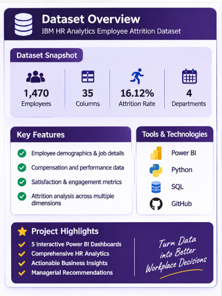
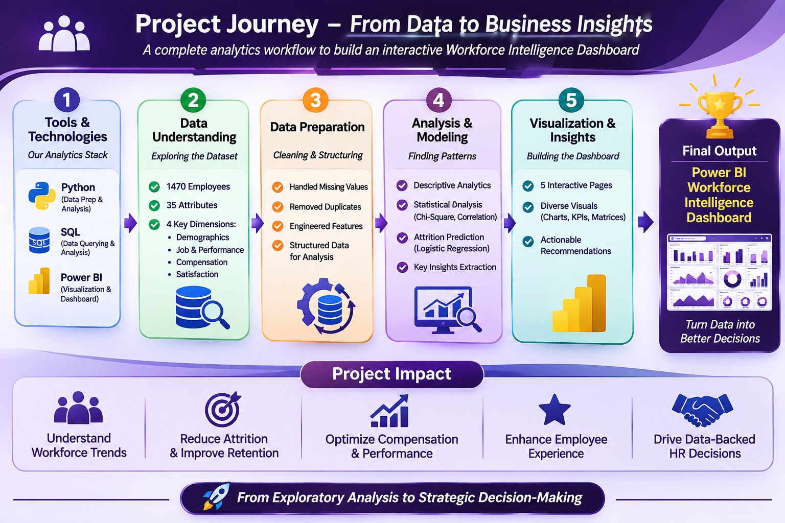
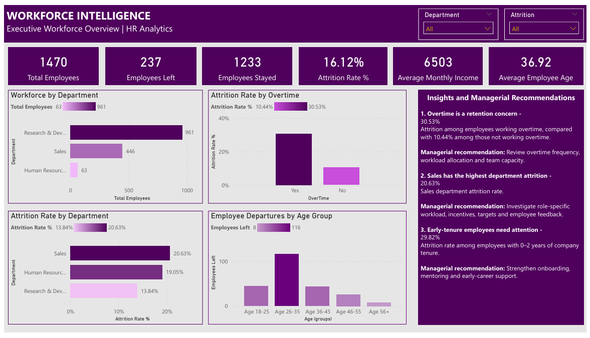
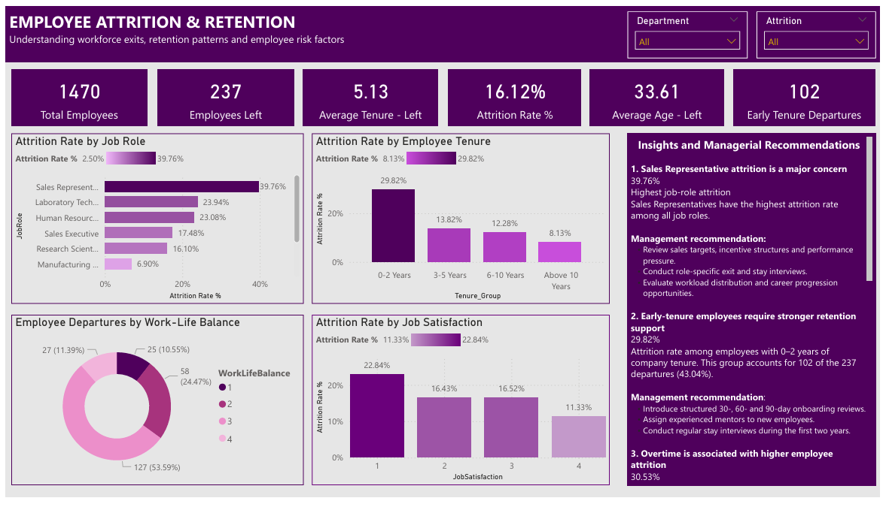
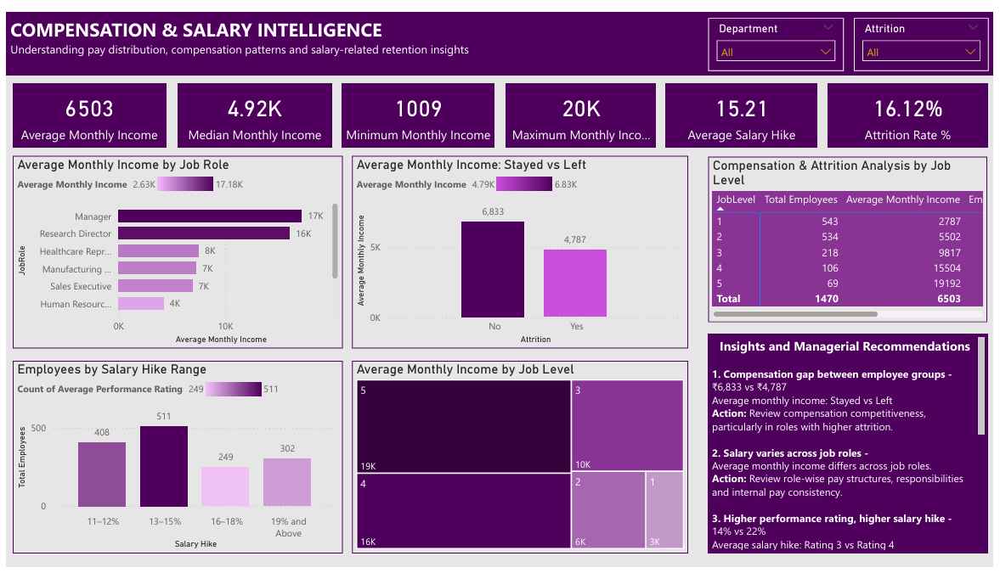
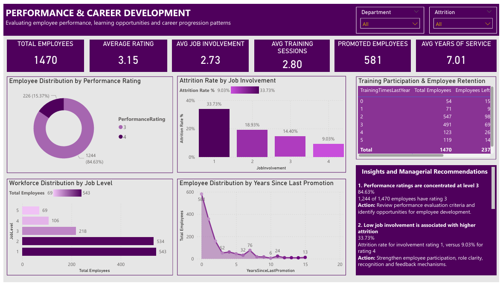
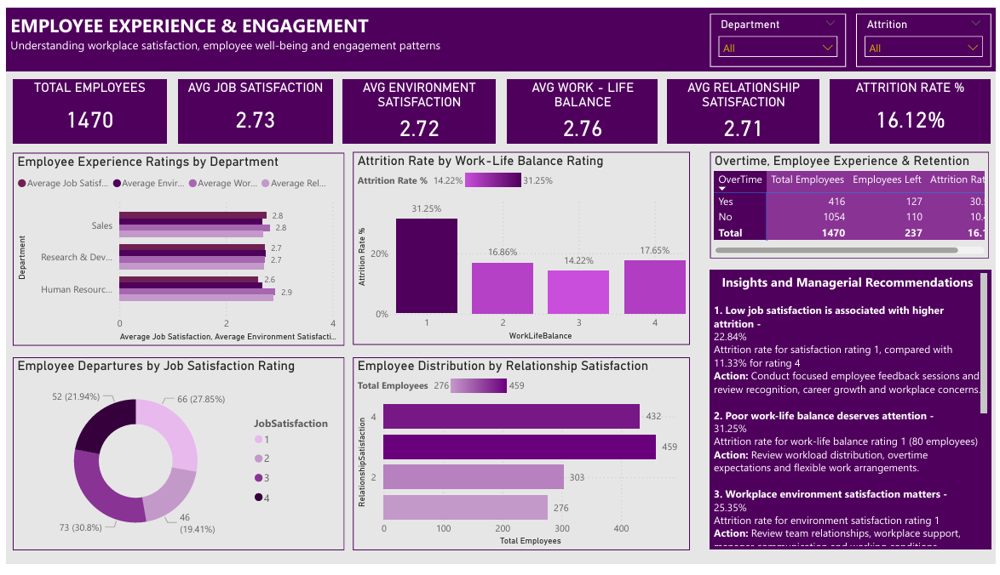

# 📊 Project 05 – HR Workforce Intelligence

### Integrated HR Analytics & Decision Support Platform

**Analyze • Understand • Empower**

An end-to-end HR analytics project exploring employee attrition, workforce demographics, compensation, performance, and employee experience using **Python, SQL, and Power BI**.

The objective is to transform employee data into meaningful business insights and actionable recommendations that support better workforce management and retention decisions.

---

## 📌 Project Overview

This project uses the IBM HR Analytics Employee Attrition & Performance dataset to investigate workforce patterns and identify factors associated with employee attrition.

The analysis combines data preparation, exploratory data analysis, SQL-based business queries, statistical testing, exploratory attrition prediction, and interactive Power BI dashboards.



### Project at a Glance

| Project Attribute | Details |
|---|---|
| Project | HR Workforce Intelligence |
| Domain | Human Resources Analytics |
| Dataset | IBM HR Analytics Employee Attrition & Performance |
| Original Records | 1,470 employees |
| Original Attributes | 35 columns |
| Cleaned Attributes | 32 columns |
| Programming | Python |
| Database | MySQL |
| Visualization | Power BI |
| Statistical Analysis | Chi-Square, Cramér's V, Mann–Whitney U |
| Predictive Modeling | Logistic Regression |
| Final Deliverable | Five-page interactive Power BI dashboard |

---

## 🛠️ Technology Stack

| Technology | Purpose |
|---|---|
| Python | Data understanding, cleaning, EDA, statistical analysis and predictive modeling |
| Pandas & NumPy | Data manipulation and numerical analysis |
| Matplotlib & Seaborn | Exploratory data visualizations |
| Scikit-learn | Preprocessing, logistic regression and model evaluation |
| SciPy | Statistical hypothesis testing |
| MySQL | Database storage and business analysis queries |
| Power BI | Interactive dashboards, KPIs and business insights |
| DAX | Measures and analytical calculations |
| Git & GitHub | Version control and project presentation |
| VS Code | Development environment |

---

## 🔄 Project Workflow

The project followed a structured analytics lifecycle, moving from raw employee data to business intelligence and recommendations.



### Phase 1 – Data Understanding

- Explored dataset dimensions, attributes and data types.
- Examined employee demographics, job roles, compensation and satisfaction.
- Identified attrition distribution and key workforce dimensions.

### Phase 2 – Data Cleaning & Preparation

- Checked missing values, duplicate records and data consistency.
- Validated employee identifiers and dataset quality.
- Removed three constant columns: `EmployeeCount`, `Over18` and `StandardHours`.
- Prepared a cleaned dataset containing 1,470 records and 32 columns.

### Phase 3 – Exploratory Data Analysis

- Analyzed employee demographics and workforce distribution.
- Examined attrition across departments, job roles and tenure groups.
- Investigated salary distribution, performance and satisfaction.
- Identified patterns associated with employee exits.

### Phase 4 – SQL Business Analysis

- Created the MySQL database and employee analytics table.
- Loaded the cleaned dataset into MySQL.
- Developed SQL queries to investigate attrition, compensation, tenure, departments and employee experience.

### Phase 5 – Statistical Analysis

- Applied Chi-Square tests to examine relationships between categorical variables and attrition.
- Used Cramér's V to assess association strength.
- Applied Mann–Whitney U tests to compare numerical employee characteristics across attrition groups.

### Phase 6 – Attrition Prediction

- Developed an exploratory Logistic Regression pipeline.
- Applied train-test splitting, numerical scaling and categorical encoding.
- Evaluated model performance using precision, recall, F1-score, ROC-AUC and a confusion matrix.

### Phase 7 – Power BI Dashboard Development

- Developed five interactive dashboard pages.
- Created DAX measures and calculated columns.
- Presented workforce KPIs, trends, comparisons and analytical findings.
- Added business insights and managerial recommendations.

---

## 📊 Power BI Dashboard

The final dashboard consists of five analytical pages designed to provide different perspectives on workforce performance and employee retention.

### 1. Executive Workforce Overview



**Focus Areas:**
- Overall workforce distribution
- Employee attrition and retention KPIs
- Department-wise workforce and attrition
- Overtime-related attrition patterns
- Employee departures by age group

### 2. Employee Attrition & Retention



**Focus Areas:**
- Attrition across job roles
- Employee tenure and retention patterns
- Job satisfaction and work-life balance
- Business travel and employee exits
- Early-tenure attrition analysis

### 3. Compensation & Salary Intelligence



**Focus Areas:**
- Salary distribution and income levels
- Compensation comparison by job role
- Salary differences between employees who stayed and left
- Salary hike distribution
- Compensation and attrition by job level

### 4. Performance & Career Development



**Focus Areas:**
- Employee performance ratings
- Job involvement and attrition
- Workforce distribution by job level
- Years since last promotion
- Training participation and employee retention

### 5. Employee Experience & Engagement



**Focus Areas:**
- Job satisfaction
- Work environment satisfaction
- Work-life balance
- Relationship satisfaction
- Overtime and employee experience

### Dashboard Files

- [Power BI Dashboard (PBIX)](05_PowerBI/Project_05_Workforce_Intelligence_Dashboard.pbix)
- [Dashboard PDF Report](05_PowerBI/Project_05_Workforce_Intelligence_Dashboard.pdf)

---

## 📈 Key Business Insights

The analysis identified several important workforce patterns.

| Area | Key Finding |
|---|---|
| Overall Attrition | 237 employees left, representing an attrition rate of 16.12%. |
| Overtime | Attrition was 30.53% among employees working overtime, compared with 10.44% among those not working overtime. |
| Early Tenure | Employees with 0–2 years of service had the highest tenure-group attrition rate at 29.82%. |
| Job Roles | Sales Representatives recorded the highest job-role attrition rate at 39.76%. |
| Compensation | Median monthly income was 3,202 among employees who left and 5,204 among employees who stayed. |
| Work-Life Balance | Employees with the lowest work-life balance rating had an attrition rate of 31.25%. |
| Business Travel | Employees who travelled frequently had an attrition rate of 24.91%. |

### Managerial Recommendations

1. **Review Overtime Practices:** Evaluate workload allocation and overtime patterns to identify potential employee burnout risks.
2. **Strengthen Early-Tenure Retention:** Improve onboarding, mentoring and structured support during the first two years.
3. **Investigate High-Risk Job Roles:** Review role expectations, workload and employee feedback in positions with elevated attrition.
4. **Evaluate Compensation Competitiveness:** Review compensation structures and internal pay differences using appropriate market benchmarks.
5. **Improve Employee Experience:** Monitor satisfaction, work-life balance and workplace environment indicators.
6. **Use Data for Targeted Retention:** Combine multiple workforce indicators rather than relying on a single metric to guide retention initiatives.

*These findings represent associations and patterns in the available dataset. They should not be interpreted as proof of causation.*

---

## 🤖 Attrition Prediction – Model Evaluation

An exploratory Logistic Regression model was developed to estimate employee attrition risk.

### Model Configuration

- Algorithm: Logistic Regression
- Train-Test Split: 80:20
- Stratification: Yes
- Random State: 42
- Class Weight: Balanced
- Numerical Processing: StandardScaler
- Categorical Processing: OneHotEncoder

### Evaluation Results

| Metric | Result |
|---|---:|
| Accuracy | 75.17% |
| Precision | 34.88% |
| Recall | 63.83% |
| F1-Score | 45.11% |
| ROC-AUC | 80.32% |

### Confusion Matrix

| | Predicted Stayed | Predicted Left |
|---|---:|---:|
| Actual Stayed | 191 | 56 |
| Actual Left | 17 | 30 |

**Model Interpretation:**

The model identified 30 of the 47 actual departures in the test dataset. It also flagged 56 employees who actually stayed.

The model prioritizes identifying potential departures, but its precision indicates that many flagged employees did not leave.

**Important:** This is an exploratory model, not a production-ready employee risk assessment system. Predictions are probabilities, not certainties, and should never be used as the sole basis for employment decisions.

---

## 📂 Repository Structure

```text
Project_05_HR_Workforce_Intelligence/
│
├── 01_Raw_Data/
│   └── 01_IBM_HR_Analytics/
│
├── 02_Cleaned_Data/
│   └── HR_Analytics_Cleaned.csv
│
├── 03_Python/
│   ├── 01_Data_Understanding.py
│   ├── 02_Data_Cleaning.py
│   ├── 03_Exploratory_Data_Analysis.py
│   ├── 04_Workforce_Compensation_Analysis.py
│   ├── 05_Attrition_Analysis.py
│   ├── 06_Performance_Experience_Analysis.py
│   ├── 07_Statistical_Analysis.py
│   ├── 08_Attrition_Prediction.py
│   └── 09_Load_Data_to_MySQL.py
│
├── 04_SQL/
│   ├── 01_Database_Creation.sql
│   ├── 02_Data_Import.sql
│   └── 03_HR_Business_Analysis.sql
│
├── 05_PowerBI/
│   ├── Project_05_Workforce_Intelligence_Dashboard.pbix
│   ├── Project_05_Workforce_Intelligence_Dashboard.pdf
│   └── Dashboard_Screenshots/
│
├── 06_Documentation/
│   ├── 01_Data_Understanding_Report.md
│   ├── 02_Data_Cleaning_Report.md
│   ├── Data_Dictionary.md
│   ├── Data_Source_Inventory.md
│   ├── Project_Methodology.md
│   ├── Business_Insights_and_Recommendations.md
│   ├── 05_Statistical_Analysis_Report.md
│   ├── 06_Attrition_Prediction_Report.md
│   └── Supporting CSV Reports
│
├── 07_Images/
│   ├── Dataset_Overview.png
│   ├── Project_Journey.png
│   ├── EDA_Charts/
│   ├── Compensation_Charts/
│   ├── Attrition_Charts/
│   ├── Performance_Experience_Charts/
│   └── Attrition_Prediction_Charts/
│
├── README.md
├── requirements.txt
└── .gitignore
```

---

## ⚠️ Dataset Scope & Limitations

- The dataset contains fictional employee records and does not represent actual IBM employees.
- It contains 1,470 employee records from a single snapshot, not a time-series workforce history.
- The analysis is limited to the variables available in the dataset.
- Recruitment funnel, hiring timelines, absenteeism, productivity and actual training ROI cannot be evaluated using the available data.
- `YearsSinceLastPromotion` represents a snapshot value and does not establish the number of actual promotions.
- Statistical associations do not establish causal relationships.
- The predictive model is exploratory and requires further validation before any real-world application.

---

## 🎯 Project Outcomes

This project demonstrates practical application of the end-to-end data analytics lifecycle:

- Data understanding and preparation using Python.
- Exploratory and statistical analysis.
- Relational database creation and SQL business querying.
- Predictive modeling using Logistic Regression.
- Interactive dashboard development using Power BI and DAX.
- Business insight generation and managerial recommendations.
- Analytical documentation and project presentation.

**The final outcome is an integrated HR Workforce Intelligence solution that transforms employee data into meaningful workforce insights and data-driven management recommendations.**

---

### Project Theme

**From Data Exploration to Workforce Intelligence.**